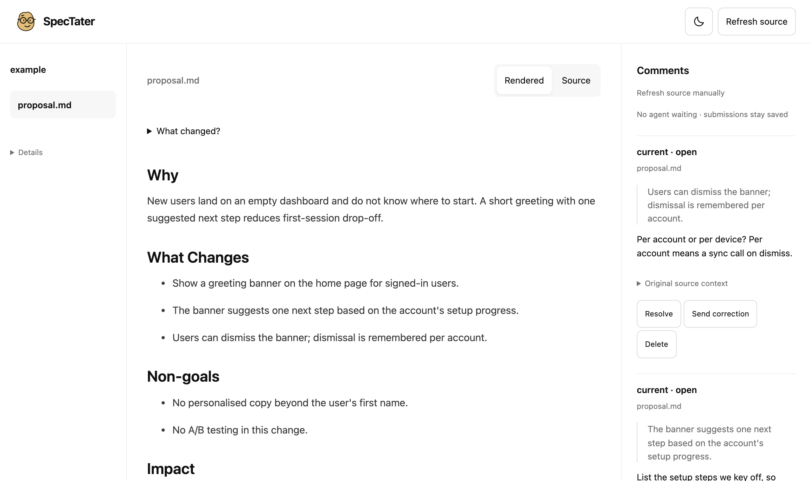

# SpecTater

[](https://github.com/morhaf-ko/spectater/actions/workflows/check.yml)
[](https://www.npmjs.com/package/spectater)
[](LICENSE)

Specs are Markdown written for agents. Reviewing them is easier on a rendered page where you can comment on the exact line.

SpecTater opens an [OpenSpec](https://github.com/Fission-AI/OpenSpec) change in your browser and sends your comments to your coding agent.

<picture>
  <source media="(prefers-color-scheme: dark)" srcset="docs/images/reader-dark.png">
  
</picture>

Your agent drafts a proposal, design, specs and tasks. SpecTater opens them in a local reader where you select text, comment, and submit. The agent receives your comments as structured JSON, revises the Markdown, and replies. The page updates as the files change. Everything stays on your machine.

## Quick start

Install the skill for your agents, in every project (`-g`):

```sh
npx skills add morhaf-ko/spectater -g
```

Then ask your agent to review a change, for example "let's go through the add-dark-mode proposal". You don't need to mention spectater: agents pick the skill when you ask to review or give feedback on an OpenSpec proposal, design, spec or tasks. The skill runs `npx -y spectater`, so there is nothing else to install.

Without the skill, tell the agent: "Run `npx -y spectater workflow` and follow it for the add-dark-mode change."

Requirements: Node 22.12 or newer, the [OpenSpec CLI](https://github.com/Fission-AI/OpenSpec) 1.15 or newer (`npm install -g @fission-ai/openspec`), and macOS, Linux or Windows (including WSL). Git is optional; it powers the "What changed" diff.

### Review every change automatically

To have agents open a review whenever they finish planning a change, add this to your project's `openspec/config.yaml`. OpenSpec passes `context` to the agent whenever it drafts an artifact (and during apply and archive), in every agent it supports. The review opens once planning is complete, not after each artifact:

```yaml
context: |
  When a change's planning artifacts are complete and `openspec validate <change>` passes, or after you revise them while planning (not while applying or archiving), open it for review with `npx -y spectater open <change>` and follow `npx -y spectater workflow`. No browser is needed: spectater prints a review URL for the user.
```

If your project doesn't use OpenSpec's workflows, put the same sentence in `AGENTS.md` or `CLAUDE.md` instead. `npx -y spectater` always runs the latest release; to pin the version for everyone who shares the config, write `npx -y spectater@<version>` instead.

## How it works

```
agent: spectater open add-dark-mode    → server starts in the background, browser opens
you:   select text, comment, Submit     → feedback is saved and queued
agent: spectater wait add-dark-mode     → receives the batch as JSON
agent: spectater reply … --status working, edits Markdown, spectater reply … --message-file result.md
you:   see the update and the reply; comment again, or click Approve when nothing is left
```

Every agent command prints one JSON object with a `status` and a `next_step`, so the agent always knows what to do next:

| `status`            | Meaning                                        | Exit code |
| ------------------- | ---------------------------------------------- | --------- |
| `batch`             | Feedback delivered in `batch`                  | 0         |
| `timeout`           | No feedback within `--timeout` (default 540 s) | 0         |
| `approved`          | You approved the change as written             | 0         |
| `ended`             | You ended the review without a decision        | 0         |
| `error`             | The command failed; see `error`                | 1         |
| `stopped`           | The review server is not running               | 3         |
| `listener_active`   | Another `wait` is already listening            | 4         |
| `listener_replaced` | Another `wait --takeover` replaced this one    | 5         |

Until the agent replies to a batch, `wait` returns that batch again, so feedback is never lost if the agent is interrupted.

`approved` tells the agent the artifacts are accepted as written and to continue with what you already asked for, such as implementing after the review; if you asked for nothing further, it asks you once. Approval never authorizes a merge or deployment. Agents that don't know `approved` follow its `next_step`.

`open` adds an `access` object when the reviewer's browser is probably on another machine; see [Agents on another machine](#agents-on-another-machine). Other commands report `ready` or `reused` (`open`), `recorded` (`reply`), `refreshed` (`refresh`), `ended` (`end`), `stopping` or `not_running` (`stop`), and `stopped` (exit 3) when no server is running. Any command can return `error` (exit 1).

## In the browser

- Select text in the rendered view or the Markdown source, then comment. Enter saves; Cmd/Ctrl+Enter saves and submits.
- Write a message to the agent that is not tied to a selection.
- Submit sends only new or changed comments. Until the agent picks a batch up you can edit or cancel it.
- One button ends the review. It reads **Send & End** while comments or a message are pending: it submits them and ends the review once the agent has received the final batch. With nothing pending it reads **Approve**: the agent receives `approved` and carries on. Next to it, **End without approving** ends the review without a decision (`ended`). After the review ends the button reads **Resume review**.
- Comments on text that later changes are marked stale (with a suggested re-anchor) or orphaned; nothing is silently moved.
- "What changed" diffs the latest source update against the previous one.
- Edits appear as the agent saves them. When an agent's sandbox blocks file watching (Codex on macOS, for example), they appear when the agent replies.

## Commands

| Command                                   | Description                                                                                                                                                    |
| ----------------------------------------- | -------------------------------------------------------------------------------------------------------------------------------------------------------------- |
| `spectater`                               | List open reviews and usage.                                                                                                                                   |
| `spectater open [change]`                 | Start or reuse the review server and open the browser (`$BROWSER` first); the change may be omitted when the project has exactly one. `--no-open`, `--reopen`. |
| `spectater wait <change>`                 | Wait for feedback. `--timeout <seconds>`, `--takeover`, `--format markdown`.                                                                                   |
| `spectater reply <change>`                | `--status working`, or post a result with `--message` / `--message-file`. `--batch <n>` targets an earlier batch.                                              |
| `spectater feedback <change> --batch <n>` | Print a submitted batch without recording delivery.                                                                                                            |
| `spectater refresh <change>`              | Re-read the change from disk.                                                                                                                                  |
| `spectater end <change>`                  | End the review.                                                                                                                                                |
| `spectater stop <change>`                 | Stop the server. Saved feedback is kept.                                                                                                                       |
| `spectater workflow`                      | Print the agent review loop.                                                                                                                                   |
| `spectater skill`                         | Print the agent skill.                                                                                                                                         |
| `spectater setup hooks`                   | Add SessionStart hooks (see below). `--remove` undoes it.                                                                                                      |

Run commands from the project directory, or pass `--project <dir>`. Use `--store <id>` for an OpenSpec store.

## Session hooks (optional)

To have new agent sessions see reviews that are already open, install SpecTater globally and add the hooks:

```sh
npm install -g spectater
spectater setup hooks
```

For each agent that is installed, this adds a SessionStart hook for Claude Code (`~/.claude/settings.json`), Codex (`~/.codex/hooks.json`; approve it once with `/hooks`), OpenCode (`~/.config/opencode/plugins/spectater.js`) and GitHub Copilot CLI (`~/.copilot/hooks/spectater.json`). The hook runs `spectater status --hook`, which prints open reviews for the current project and nothing otherwise. It never blocks or drives the agent. Restart your agent sessions afterwards.

## Agents on another machine

SpecTater treats the session as remote when the agent runs over SSH (from macOS, Linux or Windows), in a tmux session last attached over SSH, in a devcontainer, in a codespace or on a headless Linux host (including Herdr or tmux panes without SSH variables). Where detection can't tell, for example a Herdr pane on a macOS or Linux desktop you reach over SSH, set `SPECTATER_REMOTE=1` in that shell.

- **Tailscale.** When Tailscale is running with MagicDNS, the server also listens on this machine's tailnet IPv4 and prints a URL such as `http://forge.tail1234.ts.net:47420/review/…`, which opens on any device in your tailnet, phones included. This happens in local and remote sessions; agent commands stay on loopback. A configured `publicUrl` takes precedence, and `SPECTATER_TAILSCALE=0` turns it off. When `tailscale serve` or another program holds the port on the tailnet address, the review moves to the next port; if the address can't be bound at all, the review stays on loopback and the server log says why.

Without Tailscale the server listens on `127.0.0.1` only, and you reach it through a forward or a proxy you control:

- **SSH.** The server prefers port 47420 (or `port` / `SPECTATER_PORT`) and moves to the next free port in 47420–47429 when another review holds it. `open` prints the tunnel command in `access`, for example `ssh -N -L 47420:127.0.0.1:47420 forge`. To forward every review on that port, add `LocalForward 127.0.0.1:47420 127.0.0.1:47420` to the host's entry in your local `~/.ssh/config`; the forward then also serves as the fallback for a blocked tailnet or proxy URL.
- **VS Code Remote and devcontainers.** `open` uses the editor's `$BROWSER` helper, which forwards the port and opens the review on your machine. Forwarded `localhost` addresses and remapped local ports are accepted.
- **Other containers.** `docker run -p` cannot reach a server bound to the container's loopback. Forward the port with your editor, or run the container with `--network host`. `open` reports `access.mode: forward`.
- **WSL.** Treated as local: Windows browsers reach WSL2 loopback directly. If `xdg-open` is missing, the review opens in the Windows default browser.
- **`$BROWSER`.** A colon-separated (semicolon on Windows) list of commands, for example `firefox --new-window` or `chromium %s`. The first one that starts is used, and SpecTater does not wait for it to exit.
- **Codespaces.** The review URL uses the codespace's forwarded-port domain. Keep the port private.
- **`tailscale serve` or another reverse proxy.** Use this for HTTPS or a fixed port. Works with proxies that serve the review at the root of a hostname (Tailscale Serve, Cloudflare Tunnel, Gitpod or Coder subdomain apps); proxies that add a path prefix, such as code-server's `/absproxy/<port>/`, are not supported. Set `port` and `publicUrl`, and run the proxy yourself once, for example `tailscale serve --bg --https=47420 http://127.0.0.1:47420` with `"publicUrl": "https://<machine>.<tailnet>.ts.net:47420"`. Review URLs then open on any device in your tailnet. The public URL applies only while the server holds that port; a review on a fallback port gets a tunnel command instead.

SpecTater can't see Tailscale ACLs or firewalls, so a tailnet or proxy URL may hang on the reviewer's machine, for example when the tailnet grants it only `tcp:22`. In a remote session where an SSH tunnel to this host can work (not in a codespace or in a container without SSH), the `public` access object therefore also carries `command`, the same SSH tunnel command as `tunnel` mode, and `localUrl`, the loopback review URL. Agents give the reviewer both as the fallback: run `access.command`, then open `access.localUrl`.

| `access.mode` | Meaning                                                                                                                                                                     |
| ------------- | --------------------------------------------------------------------------------------------------------------------------------------------------------------------------- |
| `tunnel`      | Run `access.command` on the machine with the browser, then open the URL.                                                                                                    |
| `forward`     | Forward `access.port` from the container to the machine with the browser.                                                                                                   |
| `public`      | The URL uses your tailnet, configured proxy or the codespace's port forwarding. With `command` and `localUrl`, run the command and open `localUrl` if the URL doesn't load. |

## Configuration

No configuration is required. An optional `~/.config/spectater/config.json` (or `$XDG_CONFIG_HOME/spectater/config.json`, or `--config <file>`, or `SPECTATER_CONFIG`) accepts:

```json
{
  "defaultView": "source",
  "openBrowser": false,
  "stateDirectory": "/absolute/path",
  "port": 47420,
  "publicUrl": "https://forge.example.ts.net:47420"
}
```

| Variable                 | Effect                                                                                                                                                                                                           |
| ------------------------ | ---------------------------------------------------------------------------------------------------------------------------------------------------------------------------------------------------------------- |
| `SPECTATER_STATE_DIR`    | Where reviews are stored. Default: `~/Library/Application Support/SpecTater` on macOS, `$XDG_STATE_HOME/spectater` on Linux, `%LOCALAPPDATA%\SpecTater` on Windows, where it must stay inside your user profile. |
| `SPECTATER_REMOTE`       | `1` or `0` forces remote or local behaviour when detection is wrong, for example `1` on a macOS host reached over SSH from tmux.                                                                                 |
| `SPECTATER_PORT`         | Preferred server port; overrides `port`. Default: random locally, 47420 on a remote session. A `publicUrl` stays tied to `port`.                                                                                 |
| `SPECTATER_IDLE_TIMEOUT` | Seconds a server stays up with no reader page connected and no `wait` running, then stops itself; its URL stops working and the next `open` prints a new one. Default 1800; `0` disables.                        |
| `SPECTATER_TAILSCALE`    | `0` stops the server from listening on the tailnet address.                                                                                                                                                      |
| `SPECTATER_HERDR_CHIME`  | `1` inside [Herdr](https://herdr.dev) shows a Herdr notification with a chime when the agent starts waiting for your feedback, once per batch.                                                                   |

Review state lives outside your repository and is never uploaded. Back it up separately if you need the history.

## Security and limits

The server listens on `127.0.0.1`, plus your tailnet address when Tailscale is running, and accepts `localhost`, `127.0.0.1` or `[::1]` on any port (for forwards) plus your `publicUrl` or tailnet name. Agent commands are accepted on loopback only. The URL contains a private token in its fragment; anyone with it can read and comment on the review, so do not share it. The reader page opens from links on other sites, such as a web chat, while data requests and changes from other sites are refused. Markdown is rendered without raw HTML, scripts or remote images, and SpecTater never writes to your Markdown. Limits: 1 MiB per file, 128 artifacts, 10,000 characters per selection, comment or message. See [SECURITY.md](SECURITY.md) to report a vulnerability.

## Contributing

See [CONTRIBUTING.md](CONTRIBUTING.md). Requirements live in [`openspec/specs`](openspec/specs) and in-flight changes in [`openspec/changes`](openspec/changes).

## License

[MIT](LICENSE). Interface tokens adapt the Apache-2.0 [Open Design](https://github.com/nexu-io/open-design) Clean system; see [docs/licenses/open-design.txt](docs/licenses/open-design.txt).
